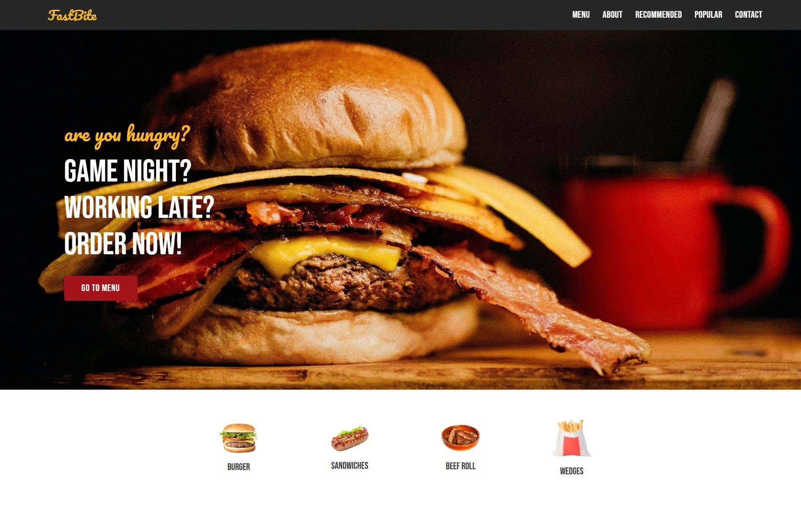

# FastBite

A responsive landing page for a fast-food restaurant, built with plain HTML, CSS and a little JavaScript. No frameworks, to practice layout fundamentals.



**Live demo:** https://smah-ir.github.io/fastbite/

## Tech stack

HTML5, CSS3 (Flexbox, custom properties, clamp()), vanilla JavaScript, Google Fonts, Font Awesome.

## Features

- Fully responsive from 320px phones to wide desktops, with no horizontal scroll
- Semantic HTML with a proper heading outline
- Accessible: visible focus states, readable color contrast, descriptive link labels, reduced-motion support
- Design tokens in CSS variables (colors and fonts defined once)
- Back-to-top button that appears after scrolling
- Performance basics: lazy-loaded images, explicit image dimensions, preloaded hero image

## Run locally

```bash
git clone https://github.com/SMAH-ir/fastbite.git
cd fastbite
```

Then open `index.html` in your browser. No build step needed.

## What I learned

I refactored this project from tag-based selectors (`.section h3`) to class-based ones (`.section-title`), so changing the heading structure for accessibility and SEO no longer breaks the styling. I also replaced the hand-typed dotted price lines with a CSS dotted leader that works at any width.